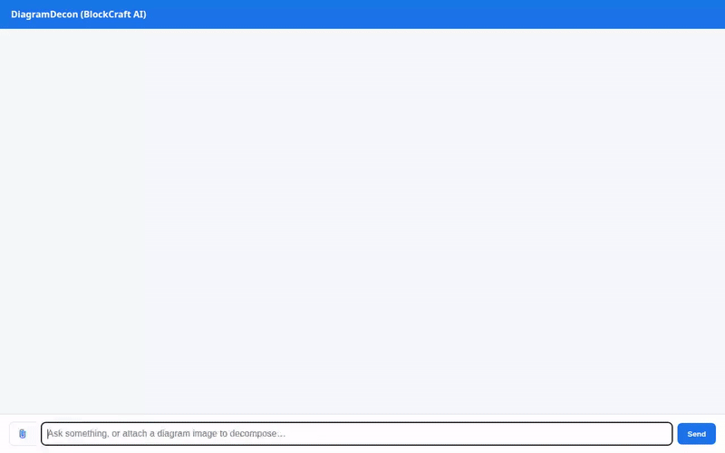

# DiagramDecon (BlockCraft AI)

DiagramDecon deconstructs architecture diagrams, system sketches, and UI wireframes into modular, reusable SVG diagram blocks and publishes them with cross-session memory and rich A2UI cards.



## Features

- **Diagram Deconstruction & Composition**: Analyzes system architectures and breaks them down into modular SVG components.
- **Firestore Block Persistence**: Saves, retrieves, and catalogs diagram components and tags with Google Cloud Firestore (`diagram_blocks` collection).
- **Public SVG Cloud Storage**: Uploads, validates, and serves compiled SVG diagrams via Google Cloud Storage.
- **Iconify Public Vector Search**: Integrates with the open-source Iconify API to search and retrieve vector icons dynamically for architecture blocks.
- **Gemini Image Generation**: Generates conceptual diagram images and saves artifacts via `gemini-3.1-flash-lite-image`.
- **A2UI Interactive Cards**: Renders structured cards (`beginRendering` / `surfaceUpdate` v0.8) for tool results directly in the chat UI.
- **Cross-Session Long-Term Memory**: Powered by Vertex AI Memory Bank (`PreloadMemoryTool` and memory generation callbacks).
- **FastAPI Chat Frontend**: Modern web UI supporting image attachments, real-time A2A communication, and 1-click SVG download.

## Project Structure

```
diagram-decon/
├── app/                        # Agent backend logic & tools
│   ├── agent.py                # Root agent with tools, callbacks, and A2UI schema
│   ├── a2ui_prompt.py          # Cached A2UI v0.8 system instructions
│   ├── a2ui_utils.py           # A2UI after_model_callback
│   ├── fast_api_app.py         # FastAPI application entrypoint
│   └── app_utils/              # Memory bank and runtime services
├── frontend/                   # Web Chat UI & A2A Proxy
│   ├── main.py                 # FastAPI proxy communicating over A2A protocol
│   ├── Dockerfile              # Cloud Run deployment Dockerfile
│   └── static/index.html       # Chat interface with attachment & SVG downloader
├── tests/                      # Integration and unit tests
├── demo.mp4                    # Full demo recording
├── demo.gif                    # Demo animation
└── pyproject.toml              # Dependencies and configuration
```

## Running Locally

### 1. Agent Runtime / Playground
```bash
uv run adk web . --port 8080 --reload_agents
```

### 2. Frontend Chat Interface
```bash
cd frontend
python3 -m venv .venv
source .venv/bin/activate
pip install -r requirements.txt
export AGENT_ENGINE_RESOURCE_NAME="projects/992988644837/locations/us-east1/reasoningEngines/5727257113038684160"
export AGENT_DIRECTORY="app"
python main.py
```
Open `http://localhost:8080` in your browser.
